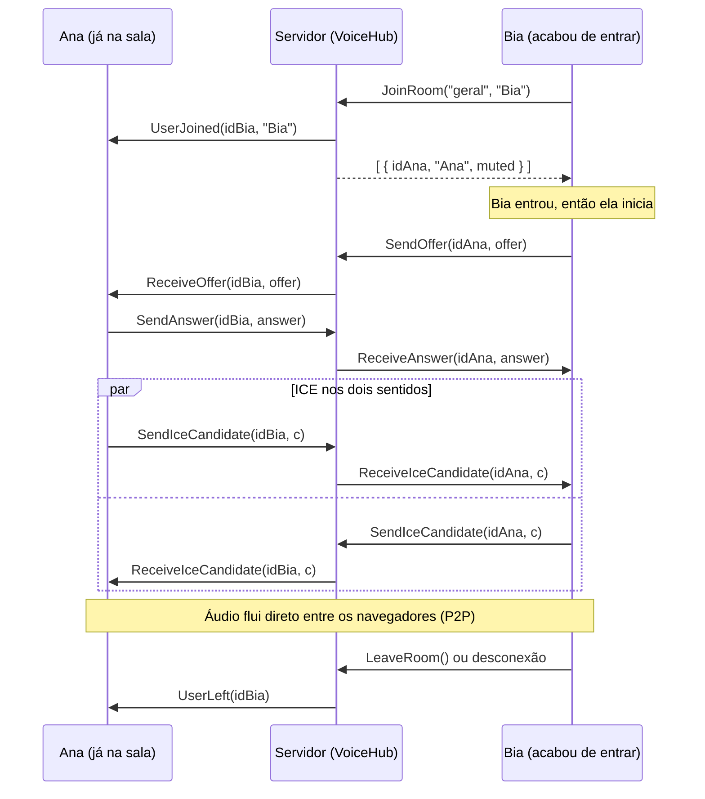

# PatoQuack — voz

MVP de chat de **voz** em tempo real no navegador, estilo Discord. Cada pessoa entra numa sala e
conversa com as outras por WebRTC em malha P2P. O servidor ASP.NET Core (.NET 10) só faz a
**sinalização** via SignalR: ele nunca transporta áudio.

## Como rodar

Pré-requisito: .NET 10 SDK.

```bash
dotnet run --project src/PatoQuack.Server
```

Abra http://localhost:5003, digite um nome e uma sala e clique em **Entrar na voz**.

### Testar com duas abas

1. Abra http://localhost:5003 em duas abas (ou `http://localhost:5003/?sala=teste` nas duas).
2. Use nomes diferentes e a mesma sala nas duas.
3. Permita o microfone. Cada aba deve mostrar a outra como **conectado**, e o avatar fica com um
   anel verde quando alguém fala.
4. Use fone de ouvido: com as duas abas na mesma máquina, o som de uma volta no microfone da outra.

### HTTPS (para testar a partir de outro dispositivo na rede)

O navegador só libera o microfone em **HTTPS ou localhost**. Para acessar de outro computador ou
do celular:

```bash
dotnet dev-certs https --trust
dotnet run --project src/PatoQuack.Server --launch-profile https
```

Isso sobe em https://localhost:7087. Para acessar de outro aparelho, é preciso um certificado
válido para o IP/host da máquina, ou um túnel HTTPS (ngrok, Cloudflare Tunnel, dev tunnels do VS).

### Testes

```bash
dotnet test
```

- `Rooms/InMemoryRoomRegistryTests`: capacidade, isolamento entre salas, mute e concorrência
  (200 entradas simultâneas nunca passam do limite).
- `Voice/VoiceHubTests`: integração com servidor em memória e clientes SignalR reais
  (repasse de offer/answer/ICE, bloqueio entre salas, limite de 6, validação, saída e desconexão).

O áudio em si (WebRTC) não tem teste automatizado: valide com o roteiro das duas abas acima.

## Estrutura

```
PatoQuack.slnx
src/PatoQuack.Server/
  Program.cs                    DI, SignalR, arquivos estáticos
  Rooms/
    IRoomRegistry.cs            contrato do registro de salas (async, pronto para Redis)
    InMemoryRoomRegistry.cs     implementação com ConcurrentDictionary + lock por sala
    Participant.cs
  Voice/
    VoiceHub.cs                 hub de sinalização em /hubs/voice
    VoiceContracts.cs           IVoiceClient (eventos do cliente), DTOs, VoiceOptions
    VoiceInput.cs               validação de sala, nome, SDP e ICE
  wwwroot/
    index.html, css/app.css
    js/config.js                STUN/TURN, constraints de áudio, limiar de "falando"
    js/signaling.js             wrapper do HubConnection (nomes dos métodos do hub)
    js/mesh.js                  MeshVoiceSession: uma RTCPeerConnection por participante
    js/speaking.js              indicador de "falando" com AnalyserNode
    js/app.js                   UI e orquestração
tests/PatoQuack.Server.Tests/
```

## Fluxo de sinalização



Regras importantes:

- **Quem entra é quem manda as offers.** Quem já estava só responde. Isso evita o *glare*
  (os dois lados mandando offer ao mesmo tempo). Por isso o cliente não cria a conexão no
  `UserJoined`, só quando recebe a offer.
- **ICE candidates que chegam cedo** (antes da `remoteDescription`, ou antes de existir a conexão)
  ficam numa fila e são aplicados depois do `setRemoteDescription`.
- **Sinalização só dentro da sala.** `SendOffer`, `SendAnswer` e `SendIceCandidate` lançam
  `HubException` se o destino não estiver na mesma sala de quem envia.
- **Entrada atômica.** A checagem do limite de 6 e a inserção acontecem sob um lock por sala. O
  cliente entra no grupo SignalR *antes* de aparecer no registro, para que duas entradas
  simultâneas não percam o `UserJoined` uma da outra.
- **Mute** desliga a track local (`track.enabled = false`, sem renegociar) e avisa a sala com
  `UserMuted`.
- **Reconexão.** O SignalR usa `withAutomaticReconnect()`. Ao reconectar, o `connectionId` muda e o
  servidor já tirou a conexão antiga da sala, então o cliente fecha as peer connections, entra de
  novo e refaz as offers.
- **Falha de conexão.** Se uma peer connection vai para `failed`, quem iniciou tenta um ICE restart
  uma vez. Se falhar de novo, a UI avisa que provavelmente falta um servidor TURN.

## Transmissão de vídeo (tela ou câmera)

Uma pessoa por sala pode transmitir a tela ou a câmera (estilo "Go Live"); os demais assistem e a
voz continua normal para todos.

- **Servidor.** O `RoomRegistry` guarda quem transmite em cada sala (no máximo 1, checado sob o lock
  da sala). `StartStream()` lança `HubException` se alguém já transmite; senão avisa a sala com
  `StreamStarted(connId, nome)`. `StopStream()` avisa com `StreamStopped(connId)`. Sair ou cair
  encerra a transmissão automaticamente. `JoinRoom` retorna `{ participants, streamer }`.
- **Cliente.** Toda `RTCPeerConnection` nasce com um transceiver de vídeo vazio em `sendrecv`
  (quem responde muda o transceiver criado pela offer para `sendrecv`). Transmitir é só
  `sender.replaceTrack(track)` em todas as conexões, sem renegociar; parar é `replaceTrack(null)`.
  Quem transmite aplica o track atual em toda conexão nova, então quem entra no meio já recebe o
  vídeo. Fechar o compartilhamento pela barra do navegador (`track.onended`) também encerra.
- **Bitrate.** Limitado a 2,5 Mbps por conexão (`VIDEO_MAX_BITRATE` em `js/config.js`). Em malha,
  quem transmite envia uma cópia para cada pessoa: com 5 assistindo, até ~12,5 Mbps de upload.

Roteiro manual: três abas na mesma sala, uma clica em **Transmitir tela** e as outras duas veem o
vídeo. Uma quarta aba entra no meio e também vê. Feche a aba de quem transmite: o player some
para os outros.

## Limitações conhecidas

- **Malha P2P escala mal.** Cada pessoa envia o próprio áudio para todas as outras: com N
  participantes, são N−1 uploads por pessoa. Funciona bem até uns **5–6 participantes** (por isso o
  limite de 6, configurável em `appsettings.json` → `Voice:MaxParticipantsPerRoom`).
- **Microfone exige HTTPS ou localhost** (`getUserMedia` só existe em contexto seguro).
- **Sem TURN, a conexão pode falhar** em algumas redes (NAT simétrico, firewall corporativo, 4G/CGNAT).
  Só há STUN (`stun:stun.l.google.com:19302`). Há um placeholder de TURN comentado em
  `wwwroot/js/config.js`.
- **Estado em memória.** Reiniciar o servidor derruba todas as salas, e não dá para rodar mais de
  uma instância.
- **Sem autenticação.** Qualquer um escolhe qualquer nome e entra em qualquer sala.

## Próximos passos previstos

**Redis no lugar do `InMemoryRoomRegistry`.** O hub depende só de `IRoomRegistry`, que já é
assíncrona. Basta criar um `RedisRoomRegistry` (por exemplo, um hash por sala e um script Lua para
o "checar limite + inserir" atômico), trocar o registro no `Program.cs` e adicionar o backplane
`AddSignalR().AddStackExchangeRedis(...)` para os grupos funcionarem entre instâncias.

**SFU (ex.: LiveKit) no lugar da malha.** Toda a lógica P2P está em `wwwroot/js/mesh.js`
(`MeshVoiceSession`). Uma `SfuVoiceSession` com os mesmos métodos e eventos (`connectTo`,
`removePeer`, `close`, `onRemoteStream`, `onPeerState`…) substitui a malha em `app.js` sem mexer na
UI. No servidor, `JoinRoom` passaria a emitir o token de acesso do SFU, e os métodos
`SendOffer/SendAnswer/SendIceCandidate` deixariam de ser usados. Presença e mute continuam no hub.

**Angular.** `signaling.js`, `mesh.js` e `speaking.js` não dependem do DOM e viram serviços
injetáveis quase sem mudança. Só `app.js` (UI) precisa ser reescrito como componentes.
