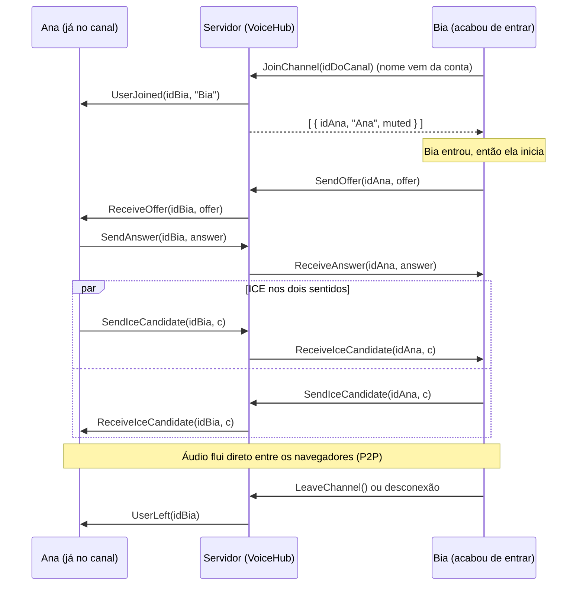

# PatoQuack — voz

MVP de chat de **voz** em tempo real no navegador, estilo Discord. Cada pessoa tem uma **conta**
(nome, usuário, e-mail e senha). Quem cria um **servidor** é o dono e gera links de convite (com
validade e limite de usos); quem abre um convite vira membro, escolhe um **canal de voz** e conversa com as outras pessoas do
canal por WebRTC em malha P2P. O servidor ASP.NET Core (.NET 10) só faz a
**sinalização** via SignalR: ele nunca transporta áudio.

## Como rodar

Pré-requisitos: .NET 10 SDK, Node.js (com npm) e Docker.

Suba o PostgreSQL local:

```bash
docker compose up -d
```

Rode o servidor (em Development as migrations são aplicadas na subida). Ele escuta em
http://localhost:5003 e expõe a API REST (`/api/auth`, `/api/servers`, `/api/invites`), o hub
SignalR (`/hubs/voice`) e `/health`:

```bash
dotnet run --project src/PatoQuack.Server
```

Em outro terminal, rode o front Angular (instale as dependências na primeira vez):

```bash
npm --prefix src/PatoQuack.Web install
```

```bash
npm --prefix src/PatoQuack.Web start
```

O `ng serve` faz proxy de `/api` e `/hubs` para o servidor (`proxy.conf.json`), então em desenvolvimento
não há CORS envolvido. Se o front for publicado em outro domínio, libere a origem em
`Cors:AllowedOrigins` no `appsettings.json` do servidor e ajuste `apiUrl` e `hubUrl` em
`src/PatoQuack.Web/src/environments/environment.production.ts`.

Connection string: `ConnectionStrings:PatoQuack` (em `appsettings.Development.json` aponta para o
container do `docker-compose.yml`; em produção use a variável `ConnectionStrings__PatoQuack`).

### Migrations (EF Core)

```bash
dotnet ef migrations add NomeDaMigration --project src/PatoQuack.Infrastructure --startup-project src/PatoQuack.Infrastructure --output-dir Persistence/Migrations
```

Fora de Development (`Database:ApplyMigrationsOnStartup = false`), aplique com:

```bash
dotnet ef database update --project src/PatoQuack.Infrastructure --startup-project src/PatoQuack.Infrastructure
```

## Fluxo

1. **Conta** (`/entrar`, `/cadastro`): tudo exige login. Entra-se com e-mail **ou** usuário + senha.
   Quem abre um link sem sessão vai para o login e volta para onde ia (`?voltar=`).
2. **Início** (`/`): seus servidores (marcados com **dono** quando são seus), criar um servidor ou
   colar um código/link de convite.
3. **Convite** (`/convite/:codigo`): mostra o servidor e o botão **Entrar no servidor**, que torna a
   pessoa membro.
4. **Servidor** (`/s/:servidor`): à esquerda, os canais de voz. Todo servidor nasce com `#geral`.
5. **Canal** (`/s/:servidor/c/:canal`): **Entrar na voz** (o nome exibido é o da conta). Com a voz
   ligada, clicar em outro canal troca direto, sem soltar o microfone. Sair da tela desliga a voz.

### Na chamada

- **Palco:** um bloco 16:9 por participante (anel verde quando fala) e um para a transmissão.
  Clicar num bloco amplia (os outros viram miniaturas no topo); clicar de novo volta para a grade.
- **Barra de controles:** microfone, câmera e tela têm botão + menu ˅:
  - **˅ do microfone:** dispositivo de entrada e de saída (quando o navegador deixa), nível de
    entrada ao vivo, volume de saída e **Desativar áudio** (não ouve ninguém e muta; desmutar
    reativa).
  - **˅ da câmera/tela:** câmera, qualidade (480p a 1080p ou "Original" na tela; 15/30/60 FPS),
    upload máximo e "sempre ver prévia". Na tela: **Parar** e **Alterar a transmissão** (outra
    tela/janela sem parar).
  - **Chat** com contador de não lidas, **⋯ Mais opções** (grade, mostrar quem não tem vídeo,
    assistir automaticamente, som de mensagens, estatísticas) e **desligar**.
- **Trocar microfone/câmera/saída no meio da chamada** não renegocia a conexão (`replaceTrack`). Se
  o microfone desconectar, volta para o padrão sozinho. As escolhas ficam salvas no navegador.
- **Cabeçalho:** canal, cronômetro, quem transmite, selo de resolução/FPS que **este** navegador está
  exibindo, "N assistindo" (para quem transmite), "Parar de assistir", janela flutuante e tela cheia.

### Chat de texto

Botão de chat na barra: o chat ocupa o palco e os blocos viram miniaturas no topo (clicar numa
miniatura amplia o bloco e recolhe o chat). As mensagens passam pelo hub (`SendChatMessage`,
`GetChatHistory`, `Typing`) e ficam na tabela `chat_messages`.

- **Histórico:** ao entrar no canal vêm as 50 mais recentes; "Carregar mensagens anteriores" busca mais.
- **Limites:** até 2.000 caracteres; 5 mensagens a cada 5 s por conexão; texto nunca vira HTML e só
  links `http`/`https` viram clicáveis (abrem em aba nova, `noopener`).
- **Retenção:** mensagens com mais de `Chat:RetentionDays` (30) dias são apagadas (ao subir e a cada hora).
- **Permissão:** enviar e ler exigem estar no canal e ser membro do servidor (conferido no banco a
  cada ação, com a permissão `SendMessages`).
- **Extras:** "Fulano está digitando…", linhas de sistema (entrou, saiu, começou/parou de transmitir —
  geradas no navegador, não guardadas), "Novas mensagens ↓" e bipe para mensagem fora da vista.

### Dono x membro

Só o **dono** gerencia os convites e pode criar, renomear e excluir canais, renomear e excluir o servidor
(com diálogo de confirmação). Membros veem os canais, entram na voz, usam o chat, veem a lista de
**Membros** e podem **Sair do servidor** (o dono não sai: ele exclui o servidor). Excluir um canal
(ou o servidor) tira da voz quem estiver nele (`ChannelDeleted`); sair do servidor faz o SERVIDOR
tirar a pessoa da chamada (`Kicked`), sem depender do navegador obedecer.

As regras ficam em `ServerPermission` (enum de flags no Domain): os casos de uso conferem
permissões, nunca "é dono?". Hoje o dono tem todas e o membro tem
`ViewChannels | ConnectVoice | SendMessages | ViewMembers` (`ServerPermissions.For`). Para roles, basta pendurar as roles em `ServerMember` e somar as
permissões delas nesse método. O front recebe a lista em `permissions` e mostra ou esconde as ações.

Quem não é membro recebe **404** (não revelamos que o servidor existe); membro sem permissão
recebe **403**.

### Convites

Menu **Convidar pessoas** (só o dono): gera um link `/convite/<código>` que vale por **1, 7 ou 30
dias** e para **1 pessoa, até 10 ou sem limite**. A janela lista os convites ativos com usos e
vencimento, e cada um pode ser **revogado**. Todo servidor novo nasce com um convite padrão
(7 dias, até 10 pessoas; `Servers:DefaultInviteDays`/`DefaultInviteMaxUses`).

- **Uso atômico:** o uso é gasto com um `UPDATE ... WHERE` que só conta se o convite ainda vale, então
  dois aceites simultâneos não passam do limite. Quem já é membro e abre o convite só é levado ao
  servidor, sem gastar uso (mesmo com o convite esgotado).
- **Códigos:** 12 caracteres sem os ambíguos (0/o, 1/l/i). Os códigos de 8 caracteres criados antes
  desta versão viraram convites **permanentes** (sem validade e sem limite) na migration
  `ServerInvites`: links já enviados continuam funcionando, e o dono pode revogá-los.
- **Inválido:** convite inexistente, vencido, esgotado ou revogado responde 404 ("Peça um novo").

### Segurança da conta

- **Bloqueio:** 5 senhas erradas seguidas bloqueiam o login por 15 minutos (`Auth:MaxFailedLogins`,
  `Auth:LockoutMinutes`); a API responde 429. Um login certo zera a contagem.
- **Limite por IP:** as rotas de conta e de convite aceitam `Auth:RateLimitPerMinute` (20) chamadas por
  minuto por IP (200 em desenvolvimento). Atrás de proxy reverso, configure os cabeçalhos
  encaminhados (`X-Forwarded-For`) para o limite enxergar o IP real.
- **CSRF:** além do cookie `SameSite=Lax`, toda chamada que muda dados na API exige o cabeçalho
  `X-PatoQuack: 1` (o interceptor do Angular manda sozinho). Um formulário de outro site não
  consegue enviá-lo sem passar pelo CORS.

### Testar com duas pessoas

O cookie de sessão é por navegador, então use dois navegadores (ou uma janela anônima):

1. No primeiro, crie uma conta, crie um servidor e copie o link de convite.
2. No segundo, abra o link, crie outra conta e clique em **Entrar no servidor**. Entrem no mesmo canal.
3. Permita o microfone. Cada aba deve mostrar a outra como **conectado**, e o avatar fica com um
   anel verde quando alguém fala.
4. Use fone de ouvido: com as duas abas na mesma máquina, o som de uma volta no microfone da outra.

### HTTPS (para testar a partir de outro dispositivo na rede)

O navegador só libera o microfone em **HTTPS ou localhost**. Para acessar de outro computador ou
do celular:

```bash
npm --prefix src/PatoQuack.Web start -- --ssl --host 0.0.0.0
```

O `ng serve` sobe em https://localhost:4200 com certificado autoassinado. Para acessar de outro aparelho, é preciso um certificado
válido para o IP/host da máquina, ou um túnel HTTPS (ngrok, Cloudflare Tunnel, dev tunnels do VS).

### Testes

```bash
dotnet test
```

Front (Vitest):

```bash
npm --prefix src/PatoQuack.Web test -- --watch=false
```

Cobrem os componentes compartilhados (botão, label, grid, avatar, menu, seleção, diálogos), o palco,
a qualidade da transmissão, os links do chat, guardas/interceptor e o tratamento de erros.

Os testes do servidor precisam do Docker rodando: o Testcontainers sobe um PostgreSQL descartável
(`Infrastructure/PostgresFixture`) compartilhado pela coleção.

- `Users/AuthServiceTests`: cadastro (normalização, duplicados, validação), login por e-mail ou
  usuário e bloqueio após 5 senhas erradas.
- `Servers/ServerServiceTests`: dono x membro x quem não é membro em cada ação, convites
  (padrão, opções, limite de usos com aceites simultâneos, revogação, validade), canais (nome único por servidor, limite), renomear e excluir.
- `Voice/VoiceSessionServiceTests`: presença contra o Postgres real: capacidade, isolamento entre
  canais, mute, transmissão e concorrência (50 entradas simultâneas nunca passam do limite).
- `Api/AuthEndpointsTests`: cadastro, login, logout, cookie HttpOnly/SameSite, 401 sem sessão,
  429 no bloqueio e recusa sem o cabeçalho `X-PatoQuack`.
- `Api/ServerEndpointsTests`: a API REST de servidores, membros, sair e convites (201/200/400/403/404/409).
- `Voice/VoiceHubTests`: integração com servidor em memória e clientes SignalR reais
  logados por cookie (conexão sem login recusada, quem não é membro não entra, repasse de
  offer/answer/ICE, bloqueio entre canais, limite de 8, saída, desconexão, canal excluído, assistir
  sob demanda, chat (histórico, validação, limite de envio) e expulsão ao sair do servidor).

O áudio em si (WebRTC) não tem teste automatizado: valide com o roteiro das duas abas acima.

## Arquitetura (hexagonal)

```
Server (adaptador de entrada: SignalR)  ──►  Application (casos de uso)  ──►  Domain (entidades + portas)
                                                                                   ▲
                                   Infrastructure (adaptador de saída: EF Core + PostgreSQL)
```

- **Domain** não depende de nada: entidades `User`, `Server`, `ServerMember`, `VoiceChannel` e
  `Participant` (sem atributos de EF), regras de nome, e-mail, usuário e convite, as permissões
  (`ServerPermission`) e as portas `IUserRepository`, `IServerRepository`,
  `IVoiceChannelRepository`, `IParticipantRepository` e `IUnitOfWork`.
- **Application** implementa os casos de uso em `AuthService` (cadastro e login), `ServerService`
  (servidores, canais e convites, sempre em nome de um usuário) e `VoiceSessionService` (presença),
  usando só as portas. O hash de senha também é uma porta (`IPasswordHasher`).
- **Infrastructure** implementa as portas com EF Core + Npgsql. Cada entidade tem sua
  `IEntityTypeConfiguration` (Fluent API) na mesma pasta do repositório dela. SQL específico do
  Postgres (`INSERT ... ON CONFLICT`, `SELECT ... FOR UPDATE`) fica só aqui.
- **Infrastructure** também implementa `IPasswordHasher` com o `PasswordHasher` do ASP.NET Core
  Identity (PBKDF2 com salt). Só a classe de hash é usada, não o resto do Identity.
- **Server** cuida da sessão: cookie HttpOnly (`pq.session`, SameSite=Lax, 14 dias deslizantes),
  que o SignalR também usa. Tem dois adaptadores de entrada: a API REST (`Api/`, que traduz os
  resultados em 201/400/401/403/404/409 com ProblemDetails) e o hub (`[Authorize]`), que chama o
  `IVoiceSessionService` e transforma o resultado em eventos SignalR. Trocar de banco = outro projeto de infraestrutura e outro `AddInfrastructure()`.

Convenção: todo método assíncrono termina em `Async`.

## Front (Angular)

`src/PatoQuack.Web` é um projeto Angular standalone com signals, separado em três camadas:

- **`shared/ui`**: componentes reutilizáveis, sem regra de negócio, todos com prefixo `pq`:
  - `button[pqButton]`: botão de atributo (mantém o `<button>` nativo) com `variant`
    (primary, secondary, danger, warning), `size`, `block`, `loading` e `pressed`.
  - `<pq-label>`: texto com `tone`/`size`; com `for` vira `<label>` de formulário.
  - `<pq-form-field>`: label + controle projetado + dica/erro.
  - `input[pqInput]`: estilo de campo sobre o `<input>` nativo (funciona com reactive forms).
  - `<pq-grid>`: grade responsiva genérica (`items` + `<ng-template pqGridItem let-item>`,
    `trackBy`, `minItemWidth`, `emptyText`) ou só layout com conteúdo projetado.
  - `<pq-card>`, `<pq-badge>`, `<pq-avatar>`, `<pq-status-message>`.
  - `<pq-icon name="mic">`: ícones em SVG (sem dependência externa).
  - `<pq-menu [(open)]>`: painel suspenso preso a um gatilho (fecha com Esc ou clique fora), com
    `button[pqMenuItem]` e `<pq-menu-separator>`.
  - `<pq-select>`, `<pq-switch>`, `<pq-range>`, `<pq-level-meter>`: campos dos menus da chamada.
  - `<pq-dialog>`, `<pq-confirm-dialog>`, `<pq-prompt-dialog>`: diálogos sobre o `<dialog>` nativo.
  - `shared/media`: diretiva `[pqMediaStream]` para ligar `MediaStream` a `<audio>`/`<video>`.
  - Os tokens de cor e espaçamento ficam em `src/styles.css` (`--pq-*`).
- **`core`**: infraestrutura do cliente, sem UI. `VoiceSignalingService` (SignalR),
  `MeshVoiceSession` (malha WebRTC), `SpeakingDetector` e `VOICE_CONFIG` (STUN/TURN,
  constraints, bitrate), injetável para trocar por ambiente ou em testes.
- **`features/voice`**: a chamada. `VoiceRoomStore` guarda o estado em signals e orquestra
  microfone, dispositivos, sinalização e transmissão (assistir sob demanda, qualidade, prévia); os
  componentes (`voice-room`, `stage`, `call-bar` com os menus, `stream-preview`, `stats-panel`,
  `voice-join-card`, `activity-log`) só leem os signals e chamam o store.
- **`features/chat`**: `ChatStore` (histórico, ao vivo, digitando, não lidas) e `chat-panel`.

## Estrutura

```
PatoQuack.slnx
docker-compose.yml              PostgreSQL local
src/PatoQuack.Domain/
  Users/User.cs, EmailAddress.cs, Username.cs, IUserRepository.cs
  Servers/Server.cs, ServerMember.cs, ServerInvite.cs, ServerPermission.cs, InviteCode.cs,
          IServerRepository.cs, IServerInviteRepository.cs
  Channels/VoiceChannel.cs, IVoiceChannelRepository.cs
  Participants/Participant.cs, IParticipantRepository.cs
  Common/DisplayName.cs         regra de nomes (1 a 32 caracteres)
  Abstractions/IUnitOfWork.cs   unidade de trabalho + transação
src/PatoQuack.Application/
  Users/IAuthService.cs, AuthService.cs, IPasswordHasher.cs
  Servers/IServerService.cs, ServerService.cs, ServerResults.cs, ServerOptions.cs
  Voice/IVoiceSessionService.cs, VoiceSessionService.cs, VoiceResults.cs, VoiceOptions.cs
  DependencyInjection.cs        AddApplication()
src/PatoQuack.Infrastructure/
  Persistence/PatoQuackDbContext.cs, UnitOfWork.cs, DesignTimeDbContextFactory.cs
  Persistence/Users/            UserRepository.cs + UserConfiguration.cs
  Persistence/Servers/          ServerRepository.cs + ServerConfiguration.cs + ServerMemberConfiguration.cs,
                                ServerInviteRepository.cs + ServerInviteConfiguration.cs
  Persistence/Channels/         VoiceChannelRepository.cs + VoiceChannelConfiguration.cs
  Persistence/Participants/     ParticipantRepository.cs + ParticipantConfiguration.cs
  Persistence/Migrations/
  Security/IdentityPasswordHasher.cs
  DependencyInjection.cs        AddInfrastructure(), MigrateDatabaseAsync()
src/PatoQuack.Server/
  Program.cs                    DI, migrations, cookie de sessão, CORS, API, SignalR
  Auth/ClaimsPrincipalExtensions.cs
  Api/
    AuthEndpoints.cs            /api/auth: register, login, logout, me
    ServerEndpoints.cs          /api/servers (listar, criar, ver, renomear, excluir; canais)
                                e /api/invites/{codigo} (ver, accept)
    AuthContracts.cs, ServerContracts.cs
  Voice/
    VoiceHub.cs                 hub de sinalização em /hubs/voice
    VoiceContracts.cs           IVoiceClient (eventos do cliente) e DTOs
    VoiceInput.cs               validação de canal, nome, SDP e ICE
src/PatoQuack.Web/              front Angular
  proxy.conf.json               /hubs -> http://localhost:5003 no ng serve
  src/styles.css                tokens de design (--pq-*)
  src/app/shared/ui/            botão, label, form-field, input, grid, card, badge, avatar, status
  src/app/shared/media/         diretiva [pqMediaStream]
  src/app/app.routes.ts         /entrar, /cadastro, /, /convite/:codigo, /s/:servidor, /s/:servidor/c/:canal
  src/app/core/                 auth (store, guards, interceptor 401), api, signaling, rtc, config
  src/app/features/auth/        login e cadastro
  src/app/features/servers/     início, convite, servidor (canais e ações do dono) e canal
  src/app/features/voice/       store, palco, barra de controles, menus, prévia e estatísticas
  src/app/features/chat/        store e painel do chat
tests/PatoQuack.Server.Tests/
```

## Fluxo de sinalização



Regras importantes:

- **Quem entra é quem manda as offers.** Quem já estava só responde. Isso evita o *glare*
  (os dois lados mandando offer ao mesmo tempo). Por isso o cliente não cria a conexão no
  `UserJoined`, só quando recebe a offer.
- **ICE candidates que chegam cedo** (antes da `remoteDescription`, ou antes de existir a conexão)
  ficam numa fila e são aplicados depois do `setRemoteDescription`.
- **Sinalização só dentro do canal.** `SendOffer`, `SendAnswer` e `SendIceCandidate` lançam
  `HubException` se o destino não estiver no mesmo canal de quem envia.
- **Entrada atômica.** A checagem do limite de 6 e a inserção acontecem numa transação com a linha
  do canal travada (`SELECT ... FOR UPDATE`). O
  cliente entra no grupo SignalR *antes* de aparecer no registro, para que duas entradas
  simultâneas não percam o `UserJoined` uma da outra.
- **Mute** desliga a track local (`track.enabled = false`, sem renegociar) e avisa o canal com
  `UserMuted`.
- **Reconexão.** O SignalR usa `withAutomaticReconnect()`. Ao reconectar, o `connectionId` muda e o
  servidor já tirou a conexão antiga do canal, então o cliente fecha as peer connections, entra de
  novo e refaz as offers.
- **Falha de conexão.** Se uma peer connection vai para `failed`, quem iniciou tenta um ICE restart
  uma vez. Se falhar de novo, a UI avisa que provavelmente falta um servidor TURN.

## Transmissão de vídeo (tela ou câmera)

Uma pessoa por canal pode transmitir a tela ou a câmera (estilo "Go Live"); os demais assistem e a
voz continua normal para todos.

- **Servidor.** A tabela `voice_channels` guarda quem transmite em cada canal
  (`streamer_connection_id`, no máximo 1, checado com o canal travado). `StartStream()` lança `HubException` se alguém já transmite; senão avisa o canal com
  `StreamStarted(connId, nome)`. `StopStream()` avisa com `StreamStopped(connId)`. Sair ou cair
  encerra a transmissão automaticamente. `JoinChannel` retorna `{ participants, streamer }`.
- **Cliente.** Toda `RTCPeerConnection` nasce com um transceiver de vídeo vazio em `sendrecv`
  (quem responde muda o transceiver criado pela offer para `sendrecv`). Transmitir é só
  `sender.replaceTrack(track)` em todas as conexões, sem renegociar; parar é `replaceTrack(null)`.
  Quem transmite aplica o track atual em toda conexão nova, então quem entra no meio já recebe o
  vídeo. Fechar o compartilhamento pela barra do navegador (`track.onended`) também encerra.
- **Assistir sob demanda.** Em malha, quem transmite codifica uma cópia por pessoa. Por isso o vídeo
  só vai para quem clica em **Assistir** (ou liga "assistir automaticamente"): o cliente chama
  `WatchStream(true|false)` e o hub avisa só quem transmite (`ViewerChanged`), que faz
  `replaceTrack` apenas nessas conexões. Por isso o canal comporta **8** pessoas.
- **Qualidade e banda.** Resolução/FPS são um teto de captura (`applyConstraints` ao vivo, sem
  recapturar). Cada resolução tem seu limite de envio, e o **upload máximo** (5/10/20 Mbps ou sem
  limite) é dividido entre quem assiste. Sem banda/CPU, a tela mantém a nitidez e cai o FPS; a
  câmera mantém o FPS e cai a resolução (`degradationPreference`).
- **Codec.** Preferimos **H.264** quando há codificador por hardware (ou no Mac): ~45% contra ~95% de
  CPU do VP8 enviando 720p para 4 pessoas. `localStorage['pq.codec'] = 'video/VP8'` força outro
  codec para comparar.
- **Prévia.** Antes de transmitir, uma janela mostra o vídeo e deixa trocar câmera/tela, qualidade e
  upload. Nada vai para a sala até confirmar; cancelar encerra a captura.
- **Estatísticas** (⋯ → Estatísticas da transmissão): por conexão, resolução, FPS, Mbps, codec,
  codificador e o que limita a qualidade (CPU ou banda); só amostra com o painel aberto.

Roteiro manual: três pessoas no mesmo canal; uma clica em **Transmitir tela** e as outras clicam no
bloco "Clique para assistir". O contador "N assistindo" sobe para quem transmite. Feche a aba de
quem transmite: o bloco some para os outros.

## Limitações conhecidas

- **Malha P2P escala mal.** Cada pessoa envia o próprio áudio para todas as outras: com N
  participantes, são N−1 uploads por pessoa. Com o vídeo só para quem assiste, funciona até uns
  **8 participantes** (limite configurável em `appsettings.json` → `Voice:MaxParticipantsPerChannel`). Canais por servidor: `Servers:MaxChannelsPerServer` (50).
- **Microfone exige HTTPS ou localhost** (`getUserMedia` só existe em contexto seguro).
- **Sem TURN, a conexão pode falhar** em algumas redes (NAT simétrico, firewall corporativo, 4G/CGNAT).
  Só há STUN (`stun:stun.l.google.com:19302`). Há um placeholder de TURN comentado em
  `src/PatoQuack.Web/src/app/core/config/voice.config.ts`.
- **Outros membros não veem mudanças ao vivo** (canal criado, renomeado ou servidor renomeado):
  aparecem ao recarregar. Só a exclusão de um canal em que a pessoa está é avisada na hora.
- **Uma instância só.** A presença está no PostgreSQL, mas os grupos do SignalR ainda são locais ao
  processo e a subida do servidor apaga toda a presença (as conexões antigas morreram). Servidores e
  canais ficam.
  Para várias instâncias: backplane do SignalR e limpeza por instância (coluna com o id do servidor).
- **Cada mensagem de sinalização consulta o banco** (checagem de mesmo canal). Tranquilo no MVP; com
  carga alta, vale um cache curto.
- **Conta ainda básica.** Sem recuperação de senha, confirmação de e-mail (ambas pedem envio de
  e-mail/SMTP) nem troca de senha/nome. O dono ainda não remove membros (só os convites).
- **Chat guardado em texto puro** no banco, visível para quem é membro do servidor (com retenção de
  30 dias). Linhas de sistema não são guardadas.
- **A lista de canais não mostra quem está em cada um** (só dentro do canal).

## Próximos passos previstos

**Várias instâncias.** Adicionar o backplane `AddSignalR().AddStackExchangeRedis(...)` para os
grupos funcionarem entre instâncias, e trocar o `ResetAsync` da subida por uma limpeza por instância.

**SFU (ex.: LiveKit) no lugar da malha.** Toda a lógica P2P está em `core/rtc/mesh-voice-session.ts`
(`MeshVoiceSession`). Uma `SfuVoiceSession` com os mesmos métodos e eventos (`connectToAsync`,
`removePeer`, `close`, `onRemoteStream`, `onPeerState`…) substitui a malha no `VoiceRoomStore` sem
mexer nos componentes. No servidor, `JoinChannel` passaria a emitir o token de acesso do SFU, e os métodos
`SendOffer/SendAnswer/SendIceCandidate` deixariam de ser usados. Presença e mute continuam no hub.
